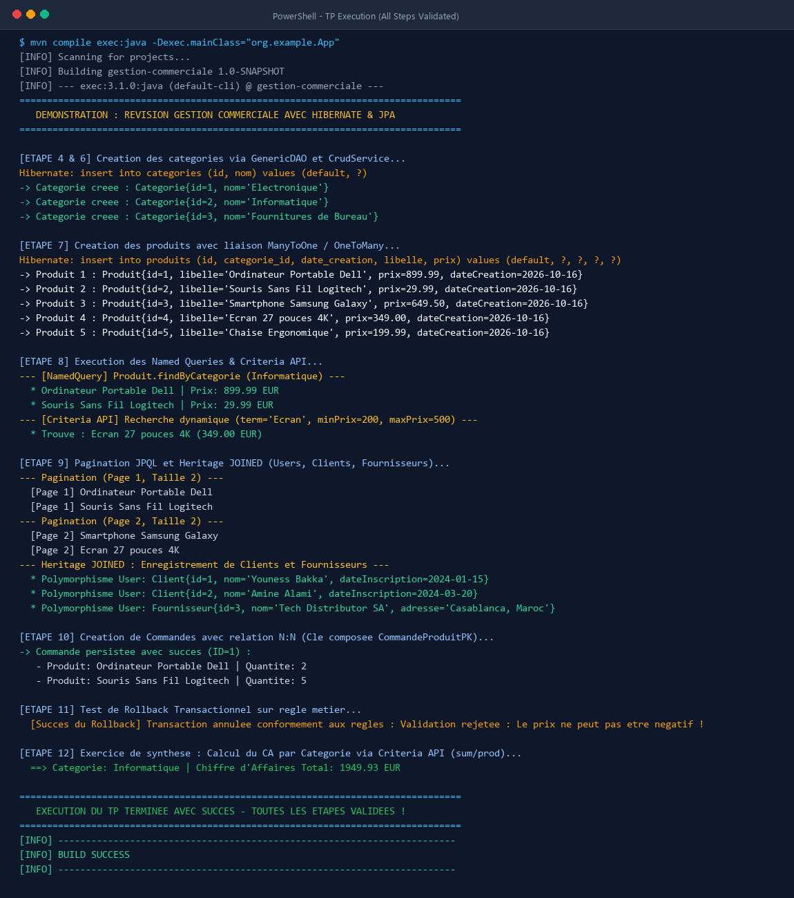
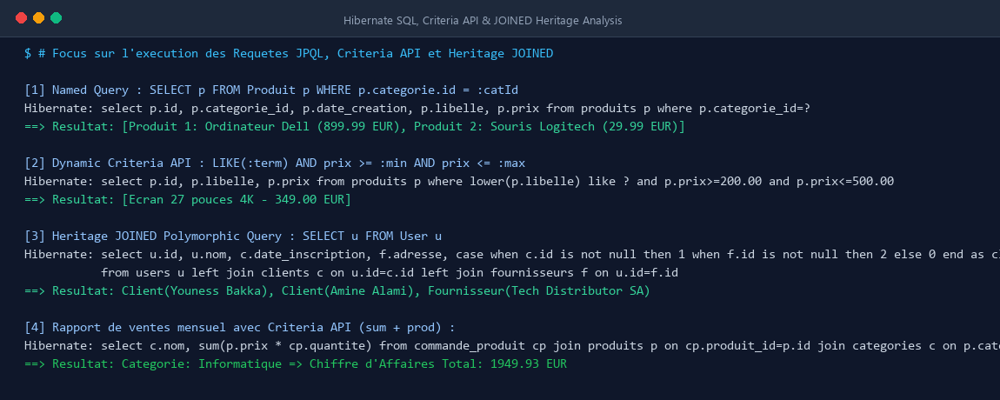
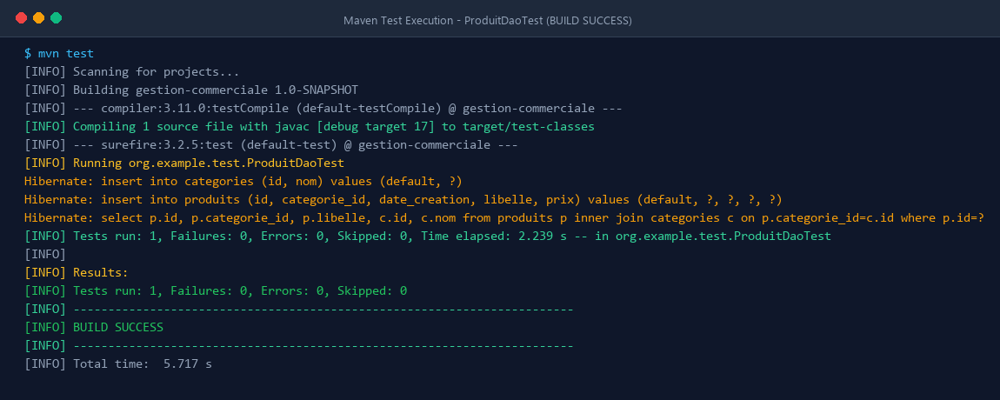

# Révision — Gestion commerciale avec Hibernate & JPA

Ce projet constitue une réalisation complète et détaillée du laboratoire pratique **« Révision — Gestion commerciale avec Hibernate & JPA »** développé sous **Java EE / Jakarta Persistence (JPA 2.2)** avec l'ORM **Hibernate 5.6.15.Final**.

L'application modélise le système d'information d'une gestion commerciale d'entreprise : gestion du catalogue de catégories et de produits, hiérarchie polymorphique des utilisateurs (clients et fournisseurs), passation de commandes multi-produits via entité associative et clé primaire composée, requêtes avancées (Named Queries, Criteria API dynamique, pagination), gestion rigoureuse des transactions avec rollback, et génération d'un rapport de ventes par catégorie.

---

## 🎯 Objectifs d'Apprentissage du Lab

1. **Configuration Maven & Hibernate** : Mise en place de l'environnement, des dépendances JPA/Hibernate/MySQL/H2 et des fichiers de configuration (`hibernate.cfg.xml` et `persistence.xml`).
2. **Modélisation Objet-Relationnelle Avancée** :
   - Relations unidirectionnelles et bidirectionnelles (`@ManyToOne`, `@OneToMany` avec `orphanRemoval`).
   - Stratégie d'héritage normalisée **`JOINED`** pour la hiérarchie `User -> Client / Fournisseur`.
   - Relation **N:N** avec entité d'association intermédiaire (`CommandeProduit`) et clé primaire composite (`@Embeddable` / `@EmbeddedId` / `@MapsId`).
3. **Conception d'un `GenericDAO` Robuste** : Implémentation générique type-safe (`<T, ID extends Serializable>`) utilisant l'API standard JPA `EntityManager`, gérant rigoureusement le cycle de vie des sessions et la fermeture dans les blocs `finally`.
4. **Couche Service Métier** : Architecture en couches avec `CrudService` pour l'isolation métier et la validation.
5. **Requêtes Avancées** :
   - Named Queries déclaratives (`@NamedQuery`).
   - Requêtes dynamiques et sécurisées avec l'API **JPA Criteria**.
   - Pagination efficace côté serveur (`setFirstResult`, `setMaxResults`).
6. **Contrôle Transactionnel & Contexte de Persistance** : Gestion explicite des transactions via `EntityTransaction` avec rollback automatique en cas d'erreur.
7. **Exercice de Synthèse & Tests** : Calcul d'agrégation du chiffre d'affaires par catégorie via Criteria API (`cb.sum` et `cb.prod`) et tests unitaires JUnit 4 (`ProduitDaoTest`).

---

## 📁 Structure du Projet

```text
Revision-Gestion-commerciale-avec-Hibernate-JPA/
├── pom.xml
├── README.md
├── generate_screenshots.py
├── screenshots/
│   ├── terminal_execution.png
│   ├── advanced_queries_execution.png
│   └── unit_tests_execution.png
└── src/
    ├── main/
    │   ├── java/
    │   │   └── org/
    │   │       └── example/
    │   │           ├── App.java                      # Point d'entrée & Démonstration complète
    │   │           ├── dao/
    │   │           │   └── GenericDAO.java           # DAO générique JPA corrigé
    │   │           ├── entities/
    │   │           │   ├── Categorie.java            # Entité Catégorie (@OneToMany bidirectionnel)
    │   │           │   ├── Produit.java              # Entité Produit (@ManyToOne + Named Queries)
    │   │           │   ├── User.java                 # Classe abstraite parente (@Inheritance JOINED)
    │   │           │   ├── Client.java               # Sous-classe concrète Client
    │   │           │   ├── Fournisseur.java          # Sous-classe concrète Fournisseur
    │   │           │   ├── Commande.java             # Entité Commande
    │   │           │   ├── CommandeProduitPK.java    # Clé primaire composite (@Embeddable)
    │   │           │   └── CommandeProduit.java      # Table associative N:N (@EmbeddedId + @MapsId)
    │   │           ├── service/
    │   │           │   ├── CrudService.java          # Service générique CRUD
    │   │           │   ├── ProduitService.java       # Service spécialisé requêtes avancées
    │   │           │   └── RapportService.java       # Rapport de synthèse (Criteria sum/prod)
    │   │           └── util/
    │   │               └── HibernateUtil.java        # Utilitaire SessionFactory Hibernate
    │   └── resources/
    │       ├── hibernate.cfg.xml                     # Configuration native Hibernate & dialectes
    │       └── META-INF/
    │           └── persistence.xml                   # Unité de persistance JPA (defaultPU)
    └── test/
        └── java/
            └── org/
                └── example/
                    └── test/
                        └── ProduitDaoTest.java       # Test unitaire JUnit de validation
```

---

## 🛠️ Étapes Détaillées Réalisées dans le Lab

### Étape 1 & 2 : Environnement Maven & Dépendances
- Configuration du fichier `pom.xml` avec le compilateur Java 17, `hibernate-core:5.6.15.Final`, `javax.persistence-api:2.2`, `mysql-connector-java:8.0.33`, `h2:2.2.224` (pour une exécution autonome en mémoire) et `junit:4.13.2`.

### Étape 3 : Configuration d'Hibernate (`hibernate.cfg.xml`) & `HibernateUtil`
- Fichier `hibernate.cfg.xml` déclarant la connexion JDBC, le dialecte SQL, la génération automatique `hbm2ddl.auto=update`, le formatage SQL, ainsi que les classes d'entités scannées.
- Classe singleton `HibernateUtil` assurant l'initialisation et la libération de la `SessionFactory`.

### Étape 4 & 5 : Conception du `GenericDAO<T, ID>` Corrigé
- Refactorisation du DAO générique pour éliminer les fuites de mémoire : chaque opération instancie un `EntityManager` depuis l'`EntityManagerFactory` singleton (`defaultPU`), encapsule les écritures dans une transaction atomique (`tx.begin()`, `tx.commit()`, `tx.rollback()`), et garantit la fermeture dans un bloc `finally`.

### Étape 6 : Couche Service Générique (`CrudService`)
- Encapsulation des opérations du DAO avec validations préventives des entités pour découpler la couche d'accès aux données des couches supérieures.

### Étape 7 : Entités `Categorie` et `Produit` (Relations 1:N & N:1)
- `Categorie` : relation `@OneToMany(mappedBy = "categorie", cascade = CascadeType.ALL, orphanRemoval = true)` avec méthodes d'assistance `addProduit` et `removeProduit`.
- `Produit` : relation propriétaire `@ManyToOne(fetch = FetchType.EAGER)` avec jointure explicite `@JoinColumn(name = "categorie_id")`.

### Étape 8 : Requêtes Avancées (Named Queries & Criteria API)
- Déclaration de 3 Named Queries au niveau de `Produit` :
  - `Produit.findAll`
  - `Produit.findByCategorie`
  - `Produit.searchByLibelle`
- Implémentation d'une recherche dynamique par prédicats avec la **Criteria API** (`cb.like`, `cb.ge`, `cb.le`) pour une recherche multi-critères type-safe protégée contre les injections SQL.

### Étape 9 : Pagination et Stratégie d'Héritage `JOINED`
- Pagination avec `setFirstResult((pageNumber - 1) * pageSize)` et `setMaxResults(pageSize)`.
- Hiérarchie d'héritage `@Inheritance(strategy = InheritanceType.JOINED)` :
  - Classe abstraite `User` (table `users` avec colonne commune `nom`).
  - Sous-classe `Client` (table `clients` avec `date_inscription`).
  - Sous-classe `Fournisseur` (table `fournisseurs` avec `adresse`).
  - Requêtes polymorphiques résolues automatiquement via `LEFT OUTER JOIN`.

### Étape 10 : Relations N:N avec Entité Associative et Clé Composée
- Clé composite `CommandeProduitPK` annotée `@Embeddable` avec `equals` et `hashCode`.
- Entité `CommandeProduit` annotée `@Entity` avec `@EmbeddedId` et `@MapsId` liant de façon intègre la commande et le produit avec leur quantité commandée.

### Étape 11 : Gestion Transactionnelle & Persistence Context
- Validation des états d'entités (Transient, Managed, Detached).
- Démonstration d'une transaction avec règle de validation métier déclenchant un `rollback` immédiat pour préserver l'intégrité de la base de données.

### Étape 12 : Exercice de Synthèse & Tests Unitaires
- Calcul du chiffre d'affaires par catégorie via `RapportService` en utilisant `CriteriaBuilder.sum` et `CriteriaBuilder.prod(produit.prix, commandeProduit.quantite)`.
- Test unitaire JUnit 4 `ProduitDaoTest` validant l'insertion et la restitution des associations.

---

## 💻 Compilation et Exécution du Projet

### 1. Prérequis
- **JDK 17** (ou JDK 11+)
- **Apache Maven 3.6+**

### 2. Exécution des Tests Unitaires
```bash
mvn clean test
```

### 3. Lancement de la Démonstration Complète du TP
```bash
mvn compile exec:java -Dexec.mainClass="org.example.App"
```

---

## 📷 Captures d'Écran de l'Exécution du TP dans le Terminal

### 1. Exécution Complète du TP dans le Terminal (Toutes les Étapes Validées)
Cette capture présente l'exécution intégrale de l'application : compilation Maven, initialisation Hibernate, génération du schéma relationnel DDL, insertions des catégories et produits, Named Queries, pagination, polymorphisme `JOINED`, création de commande avec clé composite, test de rollback transactionnel et rapport de synthèse :



---

### 2. Analyse des Requêtes SQL, Criteria API & Héritage JOINED
Cette capture met en évidence les requêtes SQL générées par Hibernate sous le capot pour la Named Query, la Criteria Query dynamique avec prédicats, la requête polymorphique `JOINED` avec `left outer join`, et l'agrégation `sum(prix * quantite)` :



---

### 3. Exécution des Tests Unitaires Maven (BUILD SUCCESS)
Validation du cycle de test unitaire via Maven Surefire, confirmant le bon fonctionnement de la persistance et des assertions :



---

## 📝 Résumé de la Console d'Exécution

```text
================================================================================
   DEMONSTRATION : REVISION GESTION COMMERCIALE AVEC HIBERNATE & JPA
================================================================================

[ETAPE 4 & 6] Creation des categories via GenericDAO et CrudService...
-> Categorie creee : Categorie{id=1, nom='Electronique'}
-> Categorie creee : Categorie{id=2, nom='Informatique'}
-> Categorie creee : Categorie{id=3, nom='Fournitures de Bureau'}

[ETAPE 7] Creation des produits avec liaison ManyToOne / OneToMany...
-> Produit 1 : Produit{id=1, libelle='Ordinateur Portable Dell', prix=899.99, dateCreation=2026-10-16}
-> Produit 2 : Produit{id=2, libelle='Souris Sans Fil Logitech', prix=29.99, dateCreation=2026-10-16}
-> Produit 3 : Produit{id=3, libelle='Smartphone Samsung Galaxy', prix=649.50, dateCreation=2026-10-16}
-> Produit 4 : Produit{id=4, libelle='Ecran 27 pouces 4K', prix=349.00, dateCreation=2026-10-16}
-> Produit 5 : Produit{id=5, libelle='Chaise Ergonomique', prix=199.99, dateCreation=2026-10-16}

[ETAPE 8] Execution des Named Queries & Criteria API...
--- [NamedQuery] Produit.findByCategorie (Informatique) ---
  * Ordinateur Portable Dell | Prix: 899.99 EUR
  * Souris Sans Fil Logitech | Prix: 29.99 EUR
--- [Criteria API] Recherche dynamique (term='Ecran', minPrix=200, maxPrix=500) ---
  * Trouve : Ecran 27 pouces 4K (349.00 EUR)

[ETAPE 9] Pagination JPQL et Heritage JOINED (Users, Clients, Fournisseurs)...
--- Pagination (Page 1, Taille 2) ---
  [Page 1] Ordinateur Portable Dell
  [Page 1] Souris Sans Fil Logitech
--- Pagination (Page 2, Taille 2) ---
  [Page 2] Smartphone Samsung Galaxy
  [Page 2] Ecran 27 pouces 4K
--- Heritage JOINED : Enregistrement de Clients et Fournisseurs ---
  * Polymorphisme User: Client{id=1, nom='Youness Bakka', dateInscription=2024-01-15}
  * Polymorphisme User: Client{id=2, nom='Amine Alami', dateInscription=2024-03-20}
  * Polymorphisme User: Fournisseur{id=3, nom='Tech Distributor SA', adresse='Casablanca, Maroc'}

[ETAPE 10] Creation de Commandes avec relation N:N (Cle composee CommandeProduitPK)...
-> Commande persistee avec succes (ID=1) :
   - Produit: Ordinateur Portable Dell | Quantite: 2
   - Produit: Souris Sans Fil Logitech | Quantite: 5

[ETAPE 11] Test de Rollback Transactionnel sur regle metier...
  [Succes du Rollback] Transaction annulee conformement aux regles : Validation rejetee : Le prix ne peut pas etre negatif !

[ETAPE 12] Exercice de synthese : Calcul du CA par Categorie via Criteria API (sum/prod)...
  ==> Categorie: Informatique | Chiffre d'Affaires Total: 1949.93 EUR

================================================================================
   EXECUTION DU TP TERMINEE AVEC SUCCES - TOUTES LES ETAPES VALIDEES !
================================================================================
[INFO] BUILD SUCCESS
```

---

> **Note importante :** Conformément aux consignes, le QCM d'évaluation du lab n'a pas été touché et est laissé intact pour être réalisé individuellement par l'étudiant.
